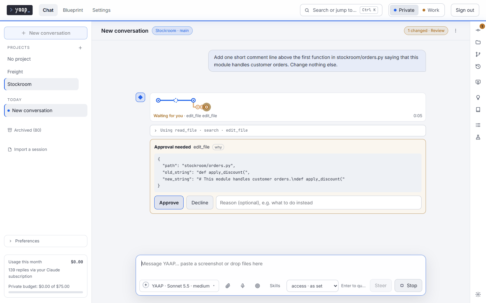
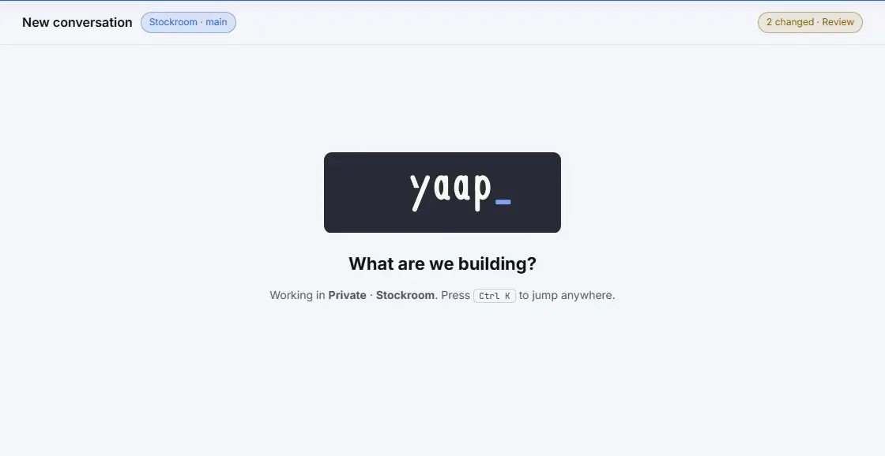
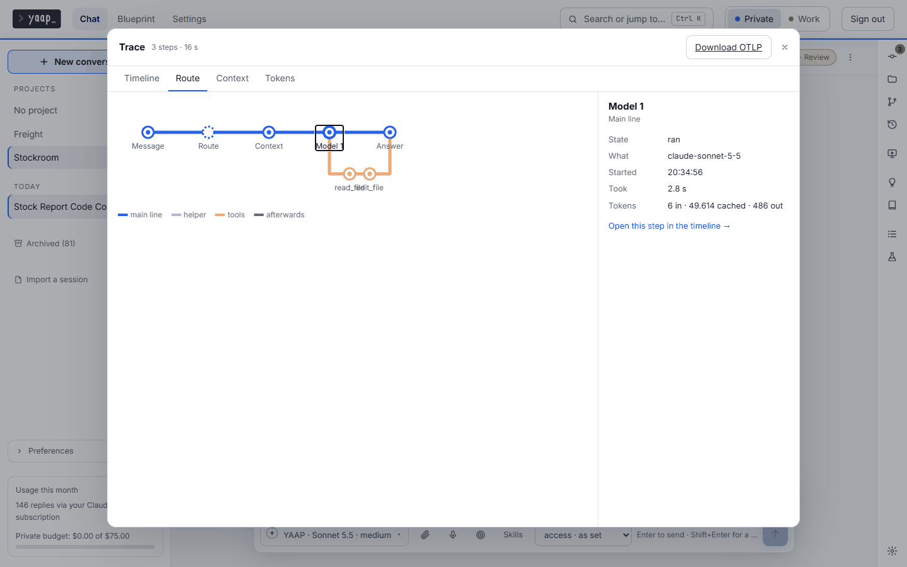
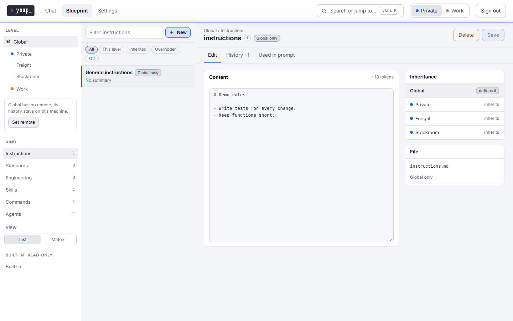
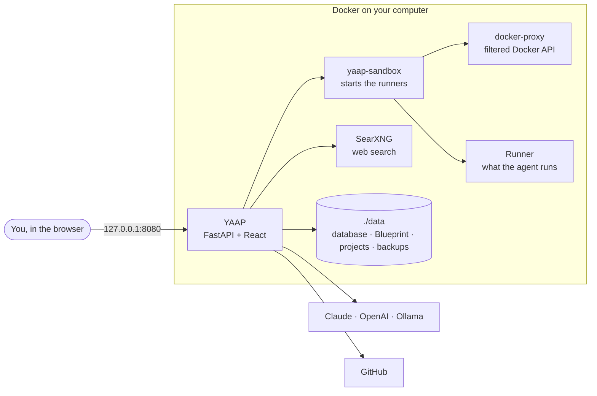

<p align="center">
  
</p>

<h3 align="center">Your own AI software factory, on your own computer</h3>

<p align="center">
  Describe the work. A strong model plans it, cheaper models build it in a copy of your project,<br>
  and YAAP checks every step before it reaches you as a reviewed branch.<br>
  <b>Any model. Your rules. Your machine.</b>
</p>

<p align="center">
  <a href="https://github.com/jelvodev/yaap/actions/workflows/ci.yml?query=branch%3Amain"></a>
  <a href="LICENSE"></a>
  
  
  
</p>

<p align="center">
  <a href="#quick-start">Quick start</a> ·
  <a href="docs/concepts.md">Concepts</a> ·
  <a href="docs/usage.md">Use</a> ·
  <a href="docs/comparison.md">Compare</a> ·
  <a href="docs/architecture.md">Architecture</a> ·
  <a href="SECURITY.md">Security</a>
</p>

---

## Why YAAP

AI coding tools are powerful, but most of them tie you to one vendor, hide what the agent did, and forget how you
like to work as soon as the conversation ends. YAAP is the other way round.

- **From idea to reviewed branch.** Every project has a board, from Inbox through Plan and Build to Done. `/plan`
  makes a plan with the checks that prove it; *Approve and build* has a cheaper worker model build it step by step in
  a copy of your project. YAAP runs the checks itself, and the review shows per acceptance criterion what was checked.
  Your files and your checked-out branch stay as they are: the result comes back as a branch of its own.
- **No lock-in.** Claude, OpenAI, local models through Ollama and other OpenAI-compatible servers, with the same tools,
  permissions and history. Sign in with the Claude or ChatGPT subscription you already have, or pay per use with an
  API key.
- **Nothing happens behind your back.** Every risky action waits for your approval with the exact change in view,
  every change has a checkpoint you can roll back, commands run in a separate runner, and secrets are used by name
  without the agent ever seeing them.
- **Your way of working, written down once.** Instructions, standards, skills and agents live in the **Blueprint**:
  Markdown files in git that every conversation follows, inherited from global to environment to project.
- **See and measure what the agent does.** A trace of every reply, replay from any model call with another model or
  rule, and eval cases per project to compare models, agents or Blueprint branches. None of Claude Code, Codex CLI,
  Cursor, OpenHands and Open WebUI documents evals ([the comparison, fact by fact](docs/comparison.md)).
- **Separate worlds.** Environments such as *Work* and *Private* each have their own keys, projects, standards and
  budget, and never see each other's.

## See it work

<p align="center"></p>

*A risky action waits for your approval: you see exactly what the agent wants to change before it happens.*

<p align="center"></p>

*Every reply draws its own route as it happens: the message, the model call and each tool call.*

<details>
<summary><b>More screenshots:</b> the trace of a reply and the Blueprint</summary>
<br>

<p align="center"></p>

*The trace of a finished reply, step by step, with the model, the time and the tokens.*

<p align="center"></p>

*The Blueprint holds your instructions, standards and skills, and shows which level each one comes from.*

</details>

## Who it is for

Developers who want an AI agent in their own projects without handing those projects to a cloud service, who switch
between models, and who like to decide how the agent works. You need Docker and a terminal for the install; after
that, everything is in the browser.

YAAP is built for one person on one computer. It is not a hosted service and not a team server.

## Quick start

You need [Docker Desktop](https://docs.docker.com/get-docker/) (Windows, macOS) or Docker Engine with Compose v2
(Linux), git, and about 10 GB of disk.

```bash
git clone https://github.com/jelvodev/yaap.git
cd yaap
```

**Windows** (PowerShell):

```powershell
powershell -ExecutionPolicy Bypass -File scripts\setup.ps1
```

**macOS or Linux**:

```bash
./scripts/setup.sh
```

The script creates `.env` with a new master key, builds and starts YAAP and asks for a password. The first build
downloads a few GB and takes several minutes.

Then open <http://127.0.0.1:8080>. The first start connects a model (an API key, or a button to sign in with your
Claude or ChatGPT subscription), creates a first project and offers YAAP's starter Blueprint. New to YAAP? Read
[YAAP in five concepts](docs/concepts.md) first; it takes two minutes.

> [!IMPORTANT]
> **Keep a copy of `YAAP_MASTER_KEY` from `.env`** in a password manager. It encrypts your keys and secrets; without
> it, a backup cannot be read.

Updating is one command (`scripts/update.ps1` or `scripts/update.sh`) with a backup first and a way back. Other
providers, updating and troubleshooting are in [docs/install.md](docs/install.md).

## What it does

| | |
|---|---|
| 🏭 **Board and builds** | A board per project, filled by you, the agent, GitHub issues or triggers such as failing CI; `/plan` with checks, a guided specification with acceptance criteria, *Approve and build* with a worker model in a copy of the project, several builds at once, versions with a budget, and one *Waiting for me* list across projects. |
| 🛠️ **An agent in your projects** | Reads, edits and runs code with your approval: lasting shells, a headless browser, web search, project memory, a live preview of the dev server. Also in folders of your own computer over SSH. |
| 🛟 **A safety net** | A checkpoint before every change, a guard against instructions hidden in web pages and files, a separate runner without YAAP's keys, and a sandbox per project when you want one. |
| 📘 **The Blueprint** | Instructions, standards, skills, commands and agents as Markdown in git; install skills and packages from GitHub, `/check` a project against its standards, see exactly what goes into the prompt. |
| 🔬 **Evals and traces** | Eval cases per project with `/eval`, compared between presets, agents or Blueprint branches; a trace of every reply and replay from any model call. |
| ⏱️ **Longer work** | Goal mode, delegation to a cheaper model or to Claude Code and Codex, scheduled tasks, a model per kind of message, and automatic compaction. |
| 🔍 **Review and Git** | A model of another vendor reviews the changes; commits, branches and pull requests with their checks. |
| 🔐 **Keys, backups and costs** | An encrypted vault, daily backups with restore from the interface, and cost per environment, project, model and month with budgets. |
| 🔌 **Open to other tools** | MCP servers, other agents over A2A, YAAP's own tools as an MCP server, and plugins of your own. |

The full tour, including chat with attachments, speech and search, is in [docs/usage.md](docs/usage.md). What YAAP
runs by itself, and what it costs, is in [behind the scenes](docs/behind-the-scenes.md).

## How it fits together



More in [docs/architecture.md](docs/architecture.md).

## Your data and security

Everything personal lives in two places that git ignores: `.env` with the master key, and the data folder `./data`
with the database, the Blueprint, your projects, attachments, sign-ins and backups. A new installation starts with an
empty Blueprint until you install [YAAP's starter](blueprint/starter). Nothing leaves your computer except the model
calls, web searches, pages and GitHub requests you cause. See
[what is personal and where it lives](docs/configuration.md#what-is-personal-and-where-it-lives).

YAAP has one password, listens on `127.0.0.1` only and answers only to its own addresses; **do not expose it to a
network**. The agent runs commands in a separate runner, with your approval unless you allow more. Read
[SECURITY.md](SECURITY.md) before you change the defaults, and report vulnerabilities privately as described there.

## Documentation

| | |
|---|---|
| [Five concepts](docs/concepts.md) | Environments, projects, the Blueprint, the runner and connections, in two minutes |
| [Installing](docs/install.md) | Setup, signing in, connecting models, the runner, updating, moving, troubleshooting |
| [Using](docs/usage.md) | A tour of the chat, projects, the board, the Blueprint and Settings |
| [Configuring](docs/configuration.md) | Environment variables, levels, connections, permissions, the vault, backups, MCP and A2A |
| [Comparison](docs/comparison.md) | YAAP next to Claude Code, Codex CLI, Cursor, OpenHands and Open WebUI, fact by fact |
| [Architecture](docs/architecture.md) | How YAAP is built, with diagrams |
| [Plugins](docs/plugins.md) | Writing a plugin of your own |
| [Blueprint packages](docs/blueprint-packages.md) | Sharing standards, skills and agents as a package |
| [Changelog](CHANGELOG.md) | What changed in each release, and what you must do when you update |
| [Roadmap](docs/roadmap.md) | What comes in the next versions, and the wish list |
| [Credits](docs/credits.md) | Where the ideas in YAAP's starter come from |
| [Contributing](CONTRIBUTING.md) | Development setup, tests and conventions |

## Status

YAAP is at version 0.8, developed actively and used every day by its developer. Every release says in the
[changelog](CHANGELOG.md) what changed and what you must do when you update, and the [roadmap](docs/roadmap.md) shows
what comes next. It is young software: expect rough edges, and please report them.

Issues and ideas are welcome; see [CONTRIBUTING.md](CONTRIBUTING.md).

## Licence

[MIT](LICENSE) © 2026 The YAAP authors
