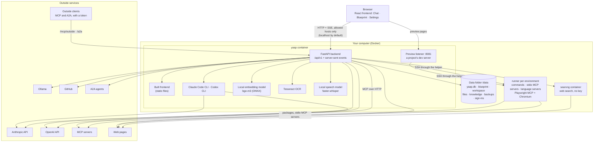
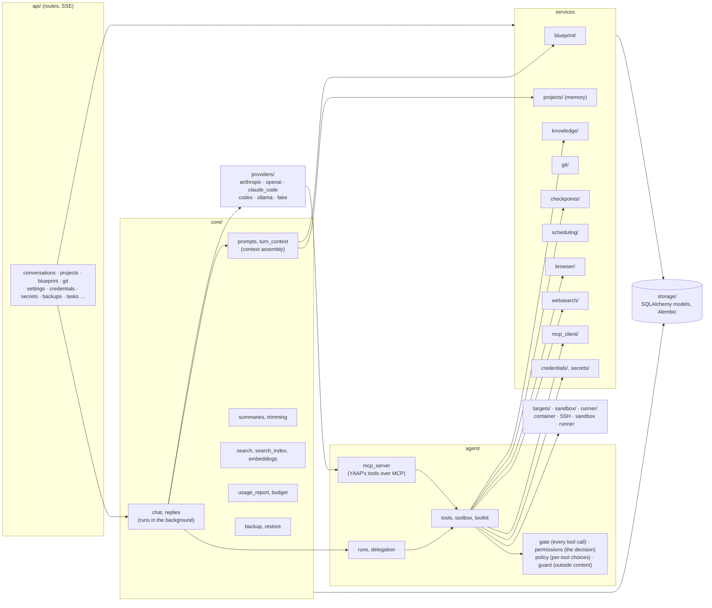
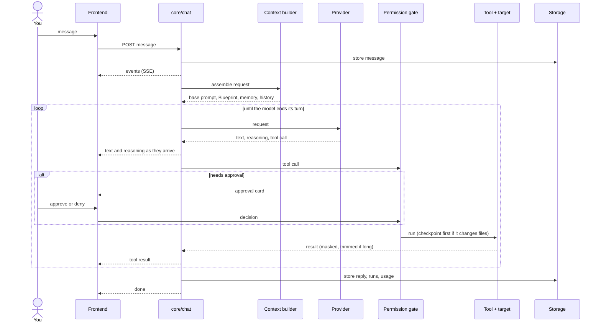
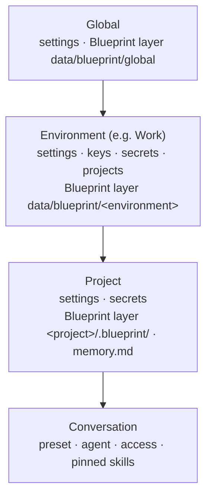
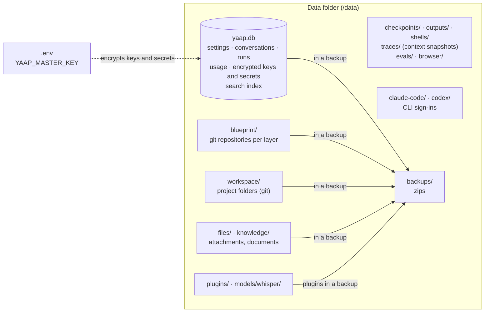
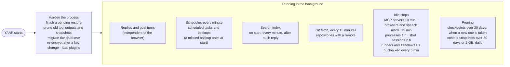

# Architecture

How YAAP is put together, in six diagrams and a table of features. This page is the map of the code.

## 1. Overview

YAAP is one application container next to a SearXNG container, reached from your browser on `127.0.0.1:8080` (and on `127.0.0.1:8081` for the preview of a project's app), with a helper that starts a *runner* per environment: the container where the agent's commands, MCP servers over stdio and browser run (section 1a). Everything it keeps is in one data folder.



- **Frontend.** React and Vite, built into the image and served by FastAPI. Commands are plain HTTP requests; replies, tool calls and approvals stream back as server-sent events.
- **Backend.** One FastAPI process. Replies run on the server, apart from the browser connection, so closing the tab does not stop them.
- **Models.** Claude and OpenAI through an API key, or through the vendors' own CLIs (Claude Code, Codex) signed in with your subscription; local models through Ollama.
- **Data.** SQLite for state, git repositories for the Blueprint and projects, plain folders for files. One folder to back up.

## 1a. Where commands run: the runner and its networks

What the agent runs (`run_command`, `start_process`, shell sessions, MCP servers over stdio, language servers, the browser) runs in the *runner* of its environment, not in YAAP's container. A runner is a sandbox container of the whole environment: it mounts only `data/workspace/<environment>` as `/workspace`, so it cannot read YAAP's database, the master key, the Claude Code and Codex sign-ins, or another environment's projects. A project that chose its own sandbox or a computer over SSH works there instead.

```mermaid
flowchart LR
    subgraph default["network default"]
        yaap["yaap<br/>FastAPI, file tools, git,<br/>checkpoints, Claude Code, Codex"]
        searxng["searxng"]
    end
    subgraph control["sandbox-control (internal)"]
        helper["yaap-sandbox helper<br/>API :8000 · SSH relay :2222"]
    end
    subgraph dockerapi["docker-api (internal)"]
        proxy["docker-socket-proxy<br/>containers + images only"]
    end
    subgraph online["yaap-sandbox-online"]
        r1["runner e1<br/>/workspace = data/workspace/work"]
        r2["runner e2<br/>/workspace = data/workspace/home"]
    end
    subgraph offline["yaap-sandbox-offline (internal, no route out)"]
        p7["sandbox p7 of a project<br/>/workspace = its project folder"]
    end
    socket[("Docker socket")]
    internet(("internet"))

    yaap --- control
    helper --- proxy
    proxy --- socket
    helper -- "relays SSH" --> r1
    helper -- "relays SSH" --> r2
    helper -- "relays SSH" --> p7
    r1 --> internet
    r2 --> internet
```

- **YAAP never shares a network with a runner or sandbox.** It reaches one only through the helper's relay: it sends the helper's token and the runner's key (`e<environment>`), the helper checks the container's labels and copies bytes; SSH runs end to end with a key YAAP made per runner and a host key YAAP made and pinned. From a runner, YAAP's API and SearXNG are unreachable.
- **Online by default.** Runners join `yaap-sandbox-online` (installing packages is normal work); the environment setting *Runner network* (Settings › Targets) moves its runner to `yaap-sandbox-offline`. Project sandboxes stay offline unless the project switches the network on. Containers on the same network can reach each other's open ports (a dev server), never each other's files.
- **The project folder is shared, not copied.** YAAP's file tools, checkpoints, git tools, semantic search and the editor work on `data/workspace/...` in YAAP's container; the runner sees the same folder at `/workspace/<project>`. Claude Code and Codex stay in YAAP and use only YAAP's tools over MCP, so their commands also go to the runner.
- **YAAP's own git runs nothing from the repository.** Because a command in the runner can write a project's `.git`, every git YAAP starts (`app/git/safety.py`: the project panel, the git tools, the periodic fetch, the Blueprint and checkpoints) skips the system and user configs, takes fixed settings at command scope that switch off hooks, the fsmonitor, pagers, editors and credential helpers, and first checks the repository's own config against the keys YAAP honours; anything else (a filter, a diff or merge driver, an include) makes it refuse git there with the key to remove. Claude Code, which runs git in the project folder for its context, gets the same.
- **Lifecycle.** The helper creates a runner on first use, from `yaap-sandbox:local` (or the image with extra packages named in the override file), starts it when it stopped, and YAAP stops it after an hour without use (no running background process). A rebuilt image makes the runner again on its next start.
- **Without the helper** (not running, image not built) commands are refused with what to do; YAAP never runs them in its own container. `YAAP_RUNNER=off` does run them in YAAP's process, for development without Docker.

## 2. Backend modules



| Folder in `backend/app/` | Responsibility |
|---|---|
| `api/` | HTTP routes and event streams under `/api/v1`, with an OpenAPI description from which the frontend's types are generated |
| `core/` | The chat and its background replies, context assembly, summaries and trimming, search and embeddings, usage and budgets, settings resolution, the choice of provider, model and key (`model_choice`), the model policy, the audit log, export, backup and restore |
| `agent/` | The agent's tools, the permission gate (`gate`) with its pure decision (`permissions`) and approvals, the outside-content guard, delegation, processes, and YAAP's own MCP server through which Claude Code and Codex call YAAP's tools |
| `agents/` | Agent definitions and run records |
| `auth/` | The local account, browser sessions, API tokens, and the host and origin checks on every request |
| `vault/` | Encrypted entries per kind with defaults, expiry and the use log, and master key rotation |
| `environments/`, `presets/` | Environments, and model presets with their roles |
| `providers/` | One adapter per model vendor behind the neutral `ModelProvider` interface; the only place for vendor code. `cli_sign_in.py` signs in to Claude Code and Codex from the browser (`/api/v1/claude-code/sign-in`, `/api/v1/codex/sign-in`): one sign-in process per CLI, each provider's spec says the command, the expected link hosts and whether a code is pasted back |
| `targets/`, `sandbox/`, `runner/` | Where the agent works: a file system confined to a folder, and a command executor: a computer over SSH, a project's sandbox, or the environment's runner (YAAP's own process only with `YAAP_RUNNER=off`) |
| `blueprint/` | Layers, merging, import, rules and skills from GitHub |
| `projects/`, `knowledge/` | Projects, project memory and memory suggestions, project knowledge |
| `git/`, `checkpoints/` | Git for projects and Blueprint layers; snapshots before each changing action |
| `credentials/`, `secrets/` | Encrypted keys and agent secrets |
| `scheduling/` | Scheduled tasks, and the backup schedule |
| `backups/` | Backup runs and their destinations: a folder or an SMB share |
| `files/`, `documents/` | The Files tab and its editor; the shared document beside a conversation |
| `imports/` | Claude Code and Codex sessions imported as conversations |
| `github/` | The GitHub API: repositories, pull requests with their checks, templates |
| `speech/` | Transcription with a local Whisper model, and the text read aloud |
| `a2a/` | Other agents over A2A as a tool, and YAAP's own agent card and tasks |
| `plugins/` | The user's own plugins: manifest, loading and the stable interface |
| `browser/`, `websearch/`, `mcp_client/` | The agent's headless browser (in the runner), web search through SearXNG, outside MCP servers (stdio ones in the runner) |
| `attachments/` | Uploads, extraction and OCR |
| `lsp/` | Language servers, one per project and language, run where the project's commands run |
| `outline/`, `repomap/` | A file's outline; the repository map at the start of a conversation |
| `preview/` | The preview of a project's app: a second listener that forwards to a dev server the agent started |
| `tracing/` | What a run did step by step, context snapshots, and the OpenTelemetry export |
| `evals/`, `replays/` | Eval cases, their checks and runs; replays of a run from one of its model calls |
| `learning/` | Signals from run steps, and the proposals made from them |
| `reviews/` | Reviews of changed code by a model of another vendor |
| `scripts/` | Command-line scripts: OpenAPI export, password reset, measurements |
| `storage/` | Database models and migrations |

The helper is a separate package, `backend/yaap_sandbox/`: its API on port 8000 starts, stops and removes runners and sandboxes through the socket proxy, and its relay on port 2222 forwards YAAP's SSH connection to them.

## 3. One reply, step by step

What happens when you send a message in a project conversation through an API-key connection. Through Claude Code or Codex the loop runs inside that CLI, which calls the same tools through YAAP's MCP server, with the same gate and approvals.



The request is built in a fixed order, stable parts first, so providers can cache the prefix: the base prompt, `instructions.md`, the summary and rules of every standard, an index of skills, commands and agents, the agent's role with the project's instructions and memory, the history, and finally your message with the date and time.

## 4. Levels and inheritance



- A setting resolves to the nearest level that sets it: project, environment, global, then the default.
- Blueprint layers merge in the same order: a file at the same path replaces the inherited one, `disabled: true` switches it off, and a skill with `extends: true` adds to it.
- Keys, the GitHub token and projects exist only per environment, so one environment never sees another's credentials, standards or memory.

## 5. Data



| | In a backup | In YAAP's git repository |
|---|---|---|
| Database, Blueprint, projects, attachments, knowledge, plugins | yes | never |
| Checkpoints, long tool outputs, screenshots | no (rebuilt as you work) | never |
| Eval runs, the agent's browser data | no | never |
| Claude Code and Codex sign-ins | no (sign in again after a restore) | never |
| The speech model (`models/whisper`) | no (downloaded again on first use) | never |
| Master key (`.env`) | no (keep it apart) | never |

A backup leaves out dependency and build folders in projects (`node_modules`, `.venv`, `dist`, `build` and the like).

Nothing leaves your computer except the requests you cause: model calls to the provider you chose, web search and pages the agent reads, git operations with GitHub, calls to MCP servers and A2A agents you configured, traces to an OpenTelemetry endpoint when you set one, and the one-time download of the speech model from Hugging Face when you first use the microphone. Embeddings for search and transcription are made locally.

## 6. Background work



## 7. Features per screen

| Feature | Where | Provided by |
|---|---|---|
| Conversations, branching, export | Chat | `core/chat`, `core/conversations`, `core/export` |
| Attachments, OCR | Chat input | `attachments/` |
| Agent tools and approvals | Chat (tool cards) | `agent/` |
| Access per conversation | Chat input | `agent/policy` |
| Goal mode, steering, queue | Chat (strips above the input) | `core/goals`, `api/activity` |
| Context meter, summaries | Chat header | `core/turn_context`, `core/summaries` |
| Project git | Project panel › Changes, History | `git/` |
| Project memory and suggestions | Project panel › Memory | `projects/memory`, `projects/suggestions` |
| Knowledge | Project panel › Knowledge | `knowledge/` |
| Scheduled tasks | Project panel › Tasks | `scheduling/` |
| Checkpoints | Chat (per tool call), Project panel › Checkpoints | `checkpoints/` |
| Processes, project settings, secrets, MCP servers | Project panel › Project, Settings › Connections › MCP servers | `agent/processes`, `secrets/`, `mcp_client/` |
| Blueprint items, import, skills from GitHub | Blueprint | `blueprint/` |
| Agents and their runs | Blueprint › Agents | `agents/`, `agent/runs` |
| Search | Ctrl K, Search page | `core/search`, `core/search_index` |
| Connections, Ollama | Settings › Connections | `providers/` |
| Keys and secrets, use log | Settings › Connections › Vault | `vault/`, `secrets/` |
| Presets and roles | Settings › Models › Presets | `presets/` |
| Permissions | Settings › Agent › Permissions | `core/settings`, `agent/policy`, `agent/permissions` |
| Default skills, languages | Settings › Agent › Default skills, Language | `core/settings` |
| Model policy | Settings › Models › Policy | `core/model_policy` |
| Repositories | Settings › Git and GitHub | `git/` |
| Usage and budgets | Settings › Usage and audit › Usage and budget | `core/usage_report`, `core/budget` |
| Audit log | Settings › Usage and audit › Audit log | `core/audit` |
| Telemetry (OpenTelemetry export) | Settings › Usage and audit › Telemetry | `tracing/` |
| Backup and restore, schedule, destinations | Settings › System › Backup | `core/backup`, `core/restore`, `backups/` |
| Context limit and compaction, repository map | Settings › Models › Context, Chat header | `core/context_control`, `repomap/` |
| Preview of a project's app | Beside the chat | `preview/` |
| Files and editor | Project panel › Files | `files/` |
| Shared document | Beside the chat | `documents/` |
| Session import | Chat | `imports/` |
| Speech | Chat input, Preferences menu | `speech/` |
| Workers for delegated tasks | Settings › Models › Utility and workers | `agent/delegation` |
| Runner, sandboxes, computers over SSH | Settings › Targets, Project panel › Project | `runner/`, `sandbox/`, `targets/` |
| Pull requests, templates | Project panel › Branches, Settings › Git and GitHub | `github/` |
| Blueprint packages | Blueprint | `blueprint/packages`, `blueprint/package_updates` |
| First start, YAAP's starter | `/welcome`, Blueprint › Add from a package | `core/first_run`, `blueprint/starter` |
| Sign-in and API tokens | Settings › Account › Access | `auth/` |
| A2A agents, YAAP for outside clients | Settings › Connections › A2A agents, Settings › Account › Access | `a2a/`, `agent/mcp_server` |
| Plugins | Settings › System › Plugins | `plugins/` |
